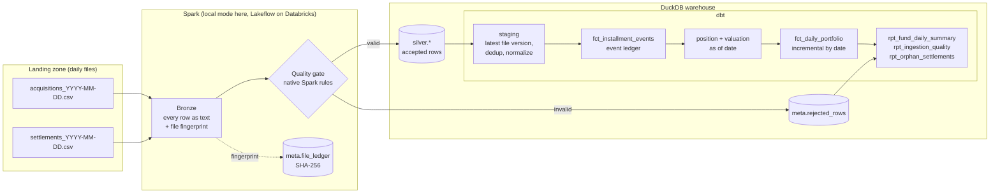

# FIDC Receivables Lakehouse

[](https://github.com/tecozu/fidc-receivables-lakehouse/actions/workflows/ci.yml)


A daily valuation pipeline for a **receivables investment fund**. It ingests the
files a fund administrator delivers each business day, keeps an event ledger of
every installment, and produces a daily snapshot of present value, loss provisions
and net portfolio value for each fund. Every step is idempotent, reproducible and tested.

> **FIDC** (*Fundo de Investimento em Direitos Creditórios*) is the Brazilian
> structure for securitizing receivables. It is roughly comparable to a
> trade-receivables / ABS fund. The fund buys invoices, bills and loans at a discount
> and has to value its portfolio every business day.

All data is **synthetic**. A seeded generator simulates realistic portfolios:
late payments, partial settlements, defaults, cancellations, and deliberately broken
rows that test the quality gate.

## Architecture



| Layer | What happens | Key design choice |
|---|---|---|
| **Bronze** (`spark_pipeline.py`) | Read every file with the layout configured for its fund, keeping each row as text with the file it came from, and fingerprint each file with its SHA-256 | Nothing is rejected at the door, so a rule can change and the silver tables can be rebuilt from bronze without asking the administrator to resend |
| **Silver** (`spark_rules.py`) | Apply the quality gate: taxpayer-ID checksums, value and date rules, keys, duplicates. Accepted rows are typed; rejected rows keep their reason and original row | The rules are native Spark column expressions with no Python UDF, and they are written **once**: the Databricks pipeline and the local runner (`ingest.py`) call the same functions |
| **Staging** (`dbt/models/staging`) | Keep only the latest version of each file, deduplicate installments and payments by their keys, normalize IDs | A corrected file re-sent under the same name **supersedes** the old one, with no manual cleanup, and a payment re-sent under a new name is never counted twice |
| **Ledger** (`fct_installment_events`) | Every acquisition, payment and cancellation becomes an event with a `balance_delta` | The outstanding balance on any date is `sum(balance_delta)`, so past dates can be rebuilt exactly |
| **Valuation** (`int_installment_*`) | Implied discount rate, present value on a 252 business-day basis, loss-provision bucket by days overdue | The B3 exchange calendar is precomputed with a running business-day counter, so business days between two dates is a subtraction and not a correlated subquery |
| **Snapshot** (`fct_daily_portfolio`) | One row per open installment per day | Incremental `delete+insert` on `as_of_date`: rerunning a date **replaces** its snapshot, which makes reprocessing safe |

**Keys.** The grain is the installment (*parcela*). An acquisition row is keyed by the
administrator's installment number (*nosso número*), and a payment points to it through
that number, which is how a payment writes the installment off the portfolio. A payment
is keyed by a transaction ID that the administrator supplies, or that the pipeline
derives as a hash when the file has none. Keys are unique per fund. The full field list,
rules and known limits are in [`docs/data-contract.md`](docs/data-contract.md).

## Adding a fund

1. Add it to `src/fidc_lakehouse/funds.yaml` with a layout per event. Use an existing layout
   (`csv_br_v1`, `csv_br_v2`) or register a new one in `layouts.py` if the administrator's
   format differs.
2. Add its provision policy to `dbt/seeds/funds.csv` and its code to the default `funds`
   list in `dbt/dbt_project.yml`. A test fails if these three lists disagree.
3. Deploy (`databricks bundle deploy`). The pipeline creates the fund's bronze and silver
   tables, empty until its first file arrives, and dbt reads them.
4. The administrator drops files in `<landing>/<FUND>/<event>/`.

No code changes: every table is created in a loop over the fund list.

## Quickstart

Prerequisites: Python 3.11+ and **Java 17 or 21** (Spark runs on the JVM; on macOS,
`brew install openjdk@21`).

```bash
git clone https://github.com/tecozu/fidc-receivables-lakehouse && cd fidc-receivables-lakehouse
uv venv && uv pip install -e ".[dev]"     # or: python -m venv .venv && pip install -e ".[dev]"
fidc demo                                 # generate Q1-2026 data and backfill every business day
```

Then explore the warehouse:

```bash
duckdb data/warehouse.duckdb "select * from marts.rpt_fund_daily_summary order by as_of_date desc limit 4"
```

Other commands:

```bash
fidc generate --start 2026-01-02 --end 2026-03-31   # write landing files only
fidc ingest --up-to 2026-01-31                      # load pending files (idempotent)
fidc run --as-of 2026-03-31                         # daily run: ingest + dbt build for one date
fidc backfill --start 2026-01-02 --end 2026-03-31   # rebuild every business day, then test
```

## Running on Databricks

The same code runs on Databricks. A [Declarative Automation Bundle](databricks.yml)
describes everything, so `databricks bundle deploy` makes the workspace match this folder.

| Piece | Where | What it does |
|---|---|---|
| Schemas and landing volume | `resources/schemas.yml` | Bronze, silver, meta and landing, in Unity Catalog |
| Ingestion pipeline | `resources/pipeline.yml`, `pipelines/` | Lakeflow pipeline: Auto Loader into bronze, the Spark rules into silver, **one set of tables per fund** so a fund's files or failure never block another |
| Daily job `fidc_daily` | `resources/jobs.yml` | Checks that `as_of_date` is a business day (a weekend or holiday skips the rest and still succeeds), delivers the day's files, runs `ingest`, then `dbt build`. dbt only starts if ingestion succeeded. The weekday schedule ships **paused** |
| Backfill job `fidc_backfill` | `resources/jobs.yml`, `jobs/make_dates.py` | Builds the lineage once, reads the business days from `dim_calendar`, builds one snapshot per day in a sequential loop, then runs every test |

**The fund administrator is simulated.** The generated files wait in an `archive` volume, and
the `deliver_files` task (`jobs/deliver_files.py`) copies those dated up to `as_of_date` into
the landing volume, skipping files already there. In production the administrator sends files
straight to landing and this step would be removed.

dbt reads the per-fund tables through one macro (`dbt/macros/silver.sql`), so the models
are the same on DuckDB and on Databricks.

**Status.** The pipeline and both jobs are deployed and verified. The ingestion matches the
local run (same installments, same totals). The daily job skips weekends and holidays (the
run succeeds and nothing is written), and the backfill rebuilt five business days in about
6 minutes (roughly 40 seconds per day), then passed the full test suite. Governance (column
masks, grants) and a dashboard are not built.

## Valuation logic

An installment with face value `F`, bought for price `P` with `n` business days to
maturity, implies an annual rate (Brazilian 252-day convention):

$$ r = \left(\frac{F}{P}\right)^{252/n} - 1 $$

On each reference date the **outstanding amount** (face minus partial payments) is
discounted at `r` over the remaining business days. Overdue installments are carried
at their outstanding amount. A **loss provision** is then applied by days-overdue bucket.
The bucket table is a versioned policy (`valid_from`/`valid_to`) inspired by Brazilian
Central Bank Resolution 2682, and each fund can follow a different policy.

```
net value = present value − present value × provision rate(days overdue, fund policy, date)
```

## Data quality

| Where | Check |
|---|---|
| Silver (Spark rules) | header must match the layout (whole file rejected otherwise), CPF/CNPJ mod-11 checksums, positive face value, `0 < price ≤ face`, valid dates, `due > acquisition`, required keys, installment number, duplicates within a file (exact copies keep one row; rows that share an installment or transaction ID but differ are all rejected) |
| dbt generic tests | uniqueness/not-null on keys, accepted values, referential integrity, `non_negative`, row-level `expression_is_true` contracts |
| dbt singular tests | **ledger reconciliation**: every snapshot's outstanding equals the ledger balance on that date · **pricing round-trip**: on the purchase date PV equals the price paid · **completeness**: no business day missing from the daily series |
| Monitoring models | `rpt_ingestion_quality` (rejection rate and reasons per file), `rpt_orphan_settlements` (payments for installments the fund does not hold; warn-level test) |

The reconciliation test caught a real bug during development. The daily run
refreshed only the snapshot model, so snapshots were computed from a ledger that
was frozen at the first build. The daily run now rebuilds the snapshot's full
lineage (`+fct_daily_portfolio`), and the intermediate models are ephemeral, so
the reference date can never be baked into a stale view.

## Project layout

```
src/fidc_lakehouse/
  funds.yaml                 fund registry -> layout per event type
  layouts.py                 file layouts (add one to onboard a new administrator)
  spark_rules.py             the quality gate as native Spark expressions
  spark_pipeline.py          bronze -> silver tables, rejected rows, file ledger (shared logic)
  ingest.py                  local runner: Spark in local mode, results loaded into DuckDB
  landing.py                 finding the landing files
  generate.py                seeded synthetic data (Faker), with injected errors
  business_calendar.py       B3 holidays (Easter-based rules) and business-day math
  pipeline.py / cli.py       daily run, backfill, demo
pipelines/                   Lakeflow pipeline code (bronze and silver tables, one set per fund)
resources/                   bundle resources: schemas, pipeline, jobs
jobs/make_dates.py           notebook that lists the business days for the backfill
databricks.yml               bundle definition and deployment targets
docs/
  data-contract.md           fields, keys and rules of the landing files
dbt/
  seeds/                     funds, provision policy, B3 holidays
  models/staging|intermediate|marts
  macros/pricing.sql         252-day rate and present value
  tests/                     reconciliation, pricing round-trip, completeness
tests/                       pytest: rules (input -> expected verdict), local runner, generator, calendar
```

## Roadmap

- Run and verify the backfill job on Databricks
- Governance: column masks for taxpayer IDs, tags and grants for analysts
- A dashboard on the marts, and alerts on job failure and rejection rate
- A parity check between DuckDB and Databricks, and a deploy workflow from GitHub
- Per-fund incremental dbt models, so one fund can be recalculated alone
- Renegotiation events (term extension with a provision floor)

## License

MIT
