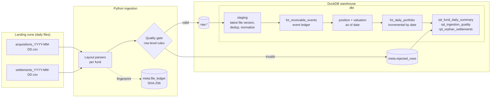

# FIDC Receivables Lakehouse

[](https://github.com/tecozu/fidc-receivables-lakehouse/actions/workflows/ci.yml)


A daily valuation pipeline for a **receivables investment fund**. It ingests the
files a fund administrator delivers each business day, keeps an event ledger of
every receivable, and produces a daily snapshot of present value, loss provisions
and net portfolio value for each fund. Every step is idempotent, reproducible and tested.

> **FIDC** (*Fundo de Investimento em Direitos Creditórios*) is the Brazilian
> structure for securitizing receivables. It is roughly comparable to a
> trade-receivables / ABS fund. The fund buys invoices, bills and loans at a discount
> and has to value its portfolio every business day.

All data is **synthetic**. A seeded generator simulates realistic portfolios:
late payments, partial settlements, defaults, cancellations, and deliberately broken
rows that test the quality gate.

## Architecture



| Layer | What happens | Key design choice |
|---|---|---|
| **Ingestion** (`src/fidc_lakehouse/ingest.py`) | Parse each file with the layout configured for its fund, validate every row (taxpayer-ID checksums, value and date rules, duplicates), load it in one transaction | SHA-256 **file ledger** makes ingestion idempotent; bad rows are quarantined with their reason and payload instead of failing the file |
| **Staging** (`dbt/models/staging`) | Keep only the latest version of each file, deduplicate receivables, normalize IDs | A corrected file re-sent under the same name **supersedes** the old one, with no manual cleanup |
| **Ledger** (`fct_receivable_events`) | Every acquisition, payment and cancellation becomes an event with a `balance_delta` | The outstanding balance on any date is `sum(balance_delta)`, so past dates can be rebuilt exactly |
| **Valuation** (`int_receivable_*`) | Implied discount rate, present value on a 252 business-day basis, loss-provision bucket by days overdue | The B3 exchange calendar is precomputed with a running business-day counter, so business days between two dates is a subtraction and not a correlated subquery |
| **Snapshot** (`fct_daily_portfolio`) | One row per open receivable per day | Incremental `delete+insert` on `as_of_date`: rerunning a date **replaces** its snapshot, which makes reprocessing safe |

## Quickstart

```bash
git clone https://github.com/tecozu/fidc-receivables-lakehouse && cd fidc-receivables-lakehouse
uv venv && uv pip install -e ".[dev]"     # or: python -m venv .venv && pip install -e ".[dev]"
fidc demo                                 # generate Q1-2026 data and backfill every business day
```

Then explore the warehouse:

```bash
duckdb data/warehouse.duckdb "select * from marts.rpt_fund_daily_summary order by as_of_date desc limit 4"
```

Other commands:

```bash
fidc generate --start 2026-01-02 --end 2026-03-31   # write landing files only
fidc ingest --up-to 2026-01-31                      # load pending files (idempotent)
fidc run --as-of 2026-03-31                         # daily run: ingest + dbt build for one date
fidc backfill --start 2026-01-02 --end 2026-03-31   # rebuild every business day, then test
```

## Valuation logic

A receivable with face value `F`, bought for price `P` with `n` business days to
maturity, implies an annual rate (Brazilian 252-day convention):

$$ r = \left(\frac{F}{P}\right)^{252/n} - 1 $$

On each reference date the **outstanding amount** (face minus partial payments) is
discounted at `r` over the remaining business days. Overdue receivables are carried
at their outstanding amount. A **loss provision** is then applied by days-overdue bucket.
The bucket table is a versioned policy (`valid_from`/`valid_to`) inspired by Brazilian
Central Bank Resolution 2682, and each fund can follow a different policy.

```
net value = present value − present value × provision rate(days overdue, fund policy, date)
```

## Data quality

| Where | Check |
|---|---|
| Ingestion (Python) | CPF/CNPJ mod-11 checksums, positive face value, `0 < price ≤ face`, valid dates, `due > acquisition`, duplicates within a file |
| dbt generic tests | uniqueness/not-null on keys, accepted values, referential integrity, `non_negative`, row-level `expression_is_true` contracts |
| dbt singular tests | **ledger reconciliation**: every snapshot's outstanding equals the ledger balance on that date · **pricing round-trip**: on the purchase date PV equals the price paid · **completeness**: no business day missing from the daily series |
| Monitoring models | `rpt_ingestion_quality` (rejection rate and reasons per file), `rpt_orphan_settlements` (payments for receivables the fund does not hold; warn-level test) |

The reconciliation test caught a real bug during development. The daily run
refreshed only the snapshot model, so snapshots were computed from a ledger that
was frozen at the first build. The daily run now rebuilds the snapshot's full
lineage (`+fct_daily_portfolio`), and the intermediate models are ephemeral, so
the reference date can never be baked into a stale view.

## Project layout

```
src/fidc_lakehouse/
  funds.yaml                 fund registry -> layout per event type
  generate.py                seeded synthetic data (Faker), with injected errors
  parsers.py                 layout registry (add a layout to onboard a new administrator)
  validation.py              quality gate: row-level rules, shared by both engines
  ingest.py                  local load into DuckDB: file ledger, transactional load
  business_calendar.py       B3 holidays (Easter-based rules) and business-day math
  pipeline.py / cli.py       daily run, backfill, demo
dbt/
  seeds/                     funds, provision policy, B3 holidays
  models/staging|intermediate|marts
  macros/pricing.sql         252-day rate and present value
  tests/                     reconciliation, pricing round-trip, completeness
tests/                       pytest: calendar, documents, generator, ingestion
```

## Roadmap

- Object storage landing (S3/MinIO) with DuckDB `httpfs`
- Orchestration with Airflow or Dagster (one asset per business day)
- Port the warehouse to BigQuery (dbt adapter swap) and add a Looker Studio dashboard
- Renegotiation events (term extension with a provision floor)

## License

MIT
